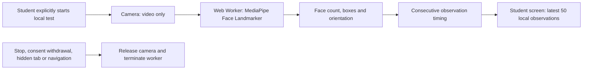

# Phase 3A — local webcam observations

[한국어 가이드](phase3a-webcam-events.ko.md)

Branch: `DoJun/phase3a-webcam-events`, based on Phase 2D `1505eee`. Phase 2 PR #33 remains separate. No Phase 3 commit, push, deployment or backend/database migration is included in this implementation.

## Scope

An opt-in student-side camera experiment, available from the overview on desktop and mobile. Face visibility, multiple nearby faces and reference-relative head geometry are processed in the browser. This is the first stage of Phase 3, not the teacher event dashboard. The existing teacher Live monitoring simulation is unchanged. Nothing is written to attendance, registration or the event API.

## Run and test

1. Install existing frontend dependencies with `npm --prefix frontend ci`.
2. Run `npm --prefix frontend run setup:webcam`. This downloads the versioned Google model, verifies its SHA-256, and copies the pinned npm runtime, WASM and notices into ignored `frontend/public/webcam-model/`. Re-run after dependency installation or before building a deployable frontend. No model download occurs from Google/CDN in an end user's browser; assets are served from the application origin.
3. Start the existing local stack as before. This machine uses `powershell -ExecutionPolicy Bypass -File .\data\local-dev\start.ps1`; stop uses `stop.ps1`. Those scripts and credentials are local ignored files, not distributed setup instructions.
4. Sign in as an approved student. On Overview/Home, choose **Open webcam movement test** below the existing attendance controls. Opening alone does not load the model or request the camera.
5. Confirm adult volunteer participation and local-analysis consent, then **Start camera test**. Model setup errors, permission denial and camera disconnection show a retryable message. The same feature works for manual-attendance students without a registered face profile and does not need the Python CV service.
6. Look forward, wait for a single-face result, and press **Set forward reference**. Slowly turn or tilt the head. The preview is intentionally unmirrored. The displayed angles are approximate changes from that captured reference, not calibrated medical or gaze measurements.
7. Move out of the frame for over ten seconds and return. With consenting participants, let a second face enter for over two seconds. See the local observations list. Missing faces do not imply absence or leaving class.
8. Stop, withdraw consent, close the test, navigate away or hide the tab. Camera tracks and the worker must stop. Resuming requires an explicit start; there is no background monitoring. Starting again resets observations and reference. Withdrawing either checkbox clears observations; stopping/hidden-tab retains the local log until restart, close or navigation.

Chrome DevTools at 390px width can test layout with a laptop webcam. Physical phones/Safari and deployment HTTPS/CSP behavior require separate verification. Camera access needs localhost or trusted HTTPS. A deployment CSP must permit the same-origin worker/runtime and WASM execution; no CSP is relaxed by this change.

## Implementation contracts and limits

| Component | Responsibility |
| --- | --- |
| `WebcamEventsEntry` | Lazy, explicit entry in desktop/mobile student overview |
| `WebcamEventsPanel` | Consent, user controls, local reference, bounded in-memory log |
| `cameraSession.ts` | Camera lifecycle, worker ownership, timeouts, no more than one outstanding frame |
| `public/webcam-worker.js` | CPU Face Landmarker VIDEO inference; face count capped at two; blendshape output disabled |
| `observationModel.ts` | Geometry conversion, relative angles and continuous-time event rules |
| `scripts/setup-webcam.mjs` | Pinned runtime check, model hash verification and local asset installation |

Worker messages: `init` → `ready` or `error`; transferred `frame {bitmap,timestamp}` → `result {timestamp,count,boxes,matrix,inferenceMs}` or `error`. Bitmaps are closed after processing; the UI retains only the latest geometry. There is no server API or student identifier in this contract. Frames, landmarks and observations are never added to localStorage, IndexedDB, a recording or a file.

The camera requests 640×480 with no audio. A 200ms delay after each result caps inference below five samples/second and avoids queuing frames. A classic Web Worker accommodates the runtime's `importScripts` WASM loader; inference never blocks the React thread. The configured CPU backend is an initial compatibility choice, not a benchmarked production capacity claim.

| Observation | Pilot rule |
| --- | --- |
| No face | Continuous valid zero-face results for 10 seconds |
| Multiple faces | Two detected faces for 2 seconds; two is a detection cap, not a reliable crowd count |
| Head turn | Absolute reference-relative yaw ≥20° for 2 seconds |
| Head tilt | Absolute reference-relative pitch or roll ≥15° for 2 seconds |
| One face | A single face with a usable pose; after reference, below movement thresholds for 1 second |
| Pose unavailable | One face but unusable geometry for 2 seconds after reference; no inferred motion |

One event is emitted per sustained state transition; brief jitter does not create repeated events. A result gap over 1.5 seconds resets continuity. Model loading/camera permission have 30-second timeouts; frozen camera frames and stalled inference stop after approximately five seconds, rather than becoming no-face events. The log holds at most 50 events. Angles and dwell thresholds are provisional and require real-device calibration. Reference capture is user-controlled, not automatic pose validation. Numbered boxes are per-frame labels, not persistent person IDs.

## Model provenance and appropriate use

`@mediapipe/tasks-vision` is pinned to 1.1.1; Face Landmarker float16 bundle version 1 is checksum-pinned in `webcam-model-manifest.json`. Runtime and model cards identify Apache-2.0 licensing; the setup copies the license and provenance notice alongside assets. See the [official web guide](https://developers.google.com/edge/mediapipe/solutions/vision/face_landmarker/web_js), [model overview](https://developers.google.com/edge/mediapipe/solutions/vision/face_landmarker), and linked model cards in `frontend/webcam-model-NOTICE.txt`.

These models target nearby front-facing faces. The BlazeFace model card explicitly lists surveillance/identity recognition as out of scope; the Face Mesh card describes AR use. This local voluntary experiment does not establish that these models are suitable for classroom monitoring. Any Phase 3B teacher-facing deployment needs a separate model-suitability, consent, privacy and deployment-jurisdiction review. Licensing alone does not establish legal permission.

No emotion, attention, fatigue, sleep, gaze-to-screen, identity or liveness classification is implemented. Head geometry alone cannot establish any of those states. No scores feed grades, attendance or discipline. Printed/replayed faces can be detected; this is not anti-spoofing. Lighting, camera position, occlusion and device speed can change results. Disabling blendshapes avoids exposing expression coefficients, but does not itself validate the remaining geometry.

## Acceptance checks and verification

- Verified on 2026-10-24: **355 frontend tests passed**, TypeScript/Vite production build passed, and patch whitespace checks passed. No backend code or schema changed.
- Actual local student login passed at desktop and 390px mobile width: the new entry opens, consent blocks startup, and the panel closes without page errors. Local services were started using the existing scripts; no attendance or registration record was changed by this check.
- Unit regression checks cover angle conversion/wrapping, no-face dwell/recovery, gaps, stale timestamps, multi-face priority, worker stop, late permission, backpressure, disconnection, timeout and playback failures.
- Real Chrome worker/model smoke checks use blank frames and a publicly supplied MediaPipe portrait fixture rendered into a synthetic camera stream: zero, one and two faces, reference capture, local-only network traffic, mobile layout and camera cleanup. This tests inference plumbing, not live-person identity or population accuracy.
- Rotating that fixture after setting the reference produced the expected sustained head-tilt event using the real model. Preview screenshots were inspected at 1280px and 390px. No page exceptions, outbound POST requests, external inference requests or horizontal overflow occurred. The MediaPipe CPU informational log and the harness's missing favicon were the only console-error-channel messages observed.
- Browser checks assert no camera request before consent/start, no POST or external inference request, stream release after stop/withdrawal/hidden tab/unmount, and no horizontal overflow at 390px. Device timing and multiple real volunteers remain a manual acceptance gate.
- No production deployment, browser support guarantee or population accuracy claim is made. Phase 3B will require authenticated event ingestion, scoped teacher access, retention and student-facing sharing controls before any remote observations are enabled.
