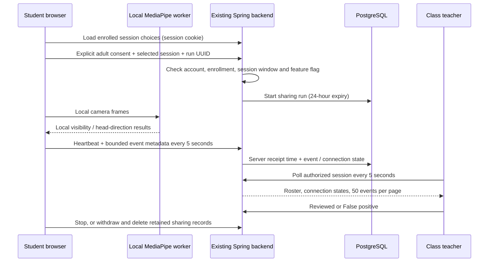

# Phase 3B: voluntary webcam observation sharing

> UI update: the student camera controls are now unified. The phase-specific steps below describe the original UI; use the [current unified-camera guide](phase3c-live-video.md) for testing. Observation sharing and live video have independent switches; deleting observations no longer stops the camera or live video.


Phase 3A runs face visibility and approximate head-direction detection in the student's browser. Phase 3B adds explicit sharing with the student's class teachers and admins, plus student summaries and optional grouped checks. Photo/manual attendance is unchanged. The Live monitoring page now shows actual opt-in connections and observations instead of its scripted camera demonstration.

## Scope and limits

- Adult volunteer pilot, disabled by default (`WEBCAM_SHARING_ENABLED=false`). Local-only camera testing remains available.
- The same MediaPipe Face Landmarker model, CPU worker and dwell thresholds from [3A](phase3a-webcam-events.md) are reused. No Python inference, YOLO, new model download or orchestration service is needed for 3B.
- Allowed observations: no face (10 seconds), one face (1 second), multiple faces, head turned/tilted from the student's reference, and unavailable direction (2 seconds). Duration is the continuous interval **before the transition event was emitted**, not the total duration of a later condition.
- Neither the model nor account login verifies who is in front of the camera. Events are untrusted, client-reported metadata. A modified client can fabricate them. No absence, attention, emotion, fatigue, sleep, disciplinary or academic outcome is inferred.
- No raw video, audio, pictures, landmarks or head-angle measurements are uploaded by this feature. No media evidence is available to reviewers.
- This is not institutional deployment approval. MediaPipe model-card surveillance limitations and suitability, applicable law, institutional policy, valid voluntary consent, security/access and backup retention must be reviewed before deployment. Adult consent alone does not settle those questions. No claim of legal permission for emotion/fatigue/attention inference is made.

## Flow



## Local setup and test

1. Use the existing Node/PostgreSQL/Spring local environment. Run `npm run setup:webcam` from `frontend` if 3A's ignored model assets are missing.
2. Set `WEBCAM_SHARING_ENABLED=true` in the **backend process** environment. With this workspace's local launcher, add it to `data/local-dev/settings.json`; that file is ignored and contains private settings, so do not commit it. `.env.example` is documentation, not automatically loaded by this launcher.
3. Restart the backend. Flyway automatically applies **V7 and V8** to an already versioned V6 database (or V8 to V7). Existing students, face profiles and attendance are untouched. Do not manually apply the legacy `database/schema.sql`, reset Flyway, or drop the database.
4. Existing local commands, from the repository root, remain:

```powershell
powershell -ExecutionPolicy Bypass -File .\data\local-dev\start.ps1
powershell -ExecutionPolicy Bypass -File .\data\local-dev\stop.ps1
```

`start.ps1` does not restart an already running backend. If applying a new build/configuration, stop then start. Open `http://127.0.0.1:5173`. Use HTTPS for later phone testing; mobile-size browser emulation does not test phone hardware.

5. Teacher: schedule a class containing the test student. Sharing opens 15 minutes before its start and closes at its end, only for scheduled/active sessions. Student must be approved and active.
6. Student: Overview → Open webcam movement test → adult confirmation and local-analysis consent. Select the class, tick the separate voluntary sharing checkbox, then **Start camera and share events**. Leaving sharing unchecked keeps the test local.
7. Teacher in a separate browser/profile: Live monitoring → choose the same session. Watch camera connection state and search students. The 20-student roster is compact; events have 50-row pagination. No video is shown.
8. Student: set the forward reference, slowly turn/tilt, then move out of the frame for at least 10 seconds. Teacher: allow roughly 5–10 additional seconds for transmission/polling, then use **Mark group reviewed** or **Group is false positive** for a displayed group. Check that photo attendance has not changed.
9. Stop the camera: teacher should see Camera off. Switch windows/minimize: capture is retained; the browser may suspend analysis. Close the panel/page: capture stops and sends best-effort stop. A lost network/abrupt browser termination expires the connection after 35 seconds; it must not generate a no-face event. Network failure stops event sharing, with no offline replay, while an already running local camera can continue. Use **Reconnect event sharing** explicitly when the connection returns. Stop/withdraw still releases the camera.
10. **Withdraw and delete shared observations** deletes all this student's retained sharing runs/events across classes, including review metadata. It does not delete face enrollment or attendance. If deletion cannot be confirmed, the UI says so and offers retry.

## Backend contracts

All routes use existing session cookies, self/staff role authorization, CSRF on writes and `Cache-Control: no-store`. Staff access is scoped to the session's class; admins use the existing admin policy. A new start replaces the student's prior live sharing run, including in another tab/class.

| Method / route under `/api/webcam` | Request | Response / behavior |
| --- | --- | --- |
| GET `/students/{student}/sessions` | Self only | enabled flag, notice version, enrolled sessions within ±1 day and `open` flag |
| POST `/students/{student}/sessions/{session}/runs` | `{id: UUID, adultConfirmed: true, sharingConsent: true, noticeVersion: "webcam-sharing-adult-pilot-v1"}` | run ID, state, last heartbeat, expiry, sequence; same active ID is idempotent |
| POST `/students/{student}/runs/{run}/pulse` | `{sequence, camera: "STARTING", "RUNNING" or "PAUSED", events: [{kind, durationMs}]}` | Updated run; strictly next sequence; duplicate sequence does not extend lease or duplicate events |
| POST `/students/{student}/runs/{run}/stop` | `{}` | Idempotent stop; late pulses cannot reopen it |
| DELETE `/students/{student}/sharing` | No body | Stop/erase all retained sharing records for self; available even when pilot disabled |
| GET `/sessions/{session}/observations?page=0&checksOnly=true` | Staff session access | Server time, enrolled roster/connections and all-retained summary counts; newest 50 pending check reports. `checksOnly=false` returns detailed history. |
| POST `/observations/{id}/review` | `{decision: "REVIEWED" or "FALSE_POSITIVE"}` | Event with reviewer timestamp; conflicting later decision is 409 |

Limits: 20 starts per student in the retained 24-hour window, 600 observations per run, 10 observations per heartbeat, at least one second between new heartbeats, durations up to 60 seconds. Server validates the current enrollment and session window again on every pulse. UUID ownership is checked independently of path authentication. Client clocks cannot extend leases or retention; `receivedAt` is the server time, not exact capture time. No-face and connected/off/disconnected are separate fields/concepts.

Writes use transactions and student/run/event locks. V7 adds `webcam_sharing_runs` and `webcam_observations` with foreign keys, allowed-value constraints and student/session/expiry/reviewer indexes. Expired rows are excluded from reads/reviews immediately; a scheduled purge physically deletes them within the next 10 minutes while the backend runs. Offline servers purge after restart. Database backup copies have their own retention policy and are not erased by an application delete.

Teacher polling is visibility-aware, has a timeout and marks failed/old responses stale. Older pages require manual refresh and may shift as new events arrive (offset pagination). Review is disabled on stale data. There is no cross-class global monitoring, image evidence, automatic attendance link, or integration into AI reports.

## Verification and next gate

- Automated service/HTTP tests cover consent, approval, enrollment/cancellation, self/staff/CSRF access, duplicate/out-of-order pulses, stale leases, start races, stop, review conflicts, expiry/deletion and unchanged attendance.
- Frontend channel tests cover late startup cleanup, one request in flight, bounded metadata, network failure, stalled frames and idempotent stop; existing 3A camera/model tests remain.
- Fresh and V6 upgrade tests validate V7/V8 using real PostgreSQL and Hibernate mappings. Browser checks cover student sharing and teacher review at desktop/mobile widths; real phone and multi-person accuracy testing remain separate.
- Before wider rollout: multi-volunteer lighting/pose tests, real phone HTTPS tests, accessibility review, load testing and an institution-approved privacy/model-use assessment. A successful local test is not a validated sleep/attention classifier.

## 3B refinement: background windows and less review work

V8 extends camera state with `PAUSED` and review state with `INFO`. V7 is unchanged. Existing pending routine events become informational; previously saved teacher decisions are preserved.

The teacher overview now uses compact student rows with connection status and optional-check counts. Summary buttons filter all students, connected cameras (including paused analysis), paused analysis, or students with pending checks. Name search and alphabetical pagination show 20 students at a time; `+` expands one student's retained counts and last heartbeat. Connection filters/counts become unavailable when updates are stale. `Review reports and detailed history` is collapsed initially. Overview status filters and student pagination do not filter the separately paginated reports; name search applies to both. This UI change adds no API or database migration. Chrome layout/interaction checks use 40 synthetic students at 1440×1080 and 390×844; this is not a concurrent-user load test.

Validation on 2026-10-25: 367 frontend tests, the production frontend build, 52 targeted backend tests, and fresh/V6-upgrade PostgreSQL schema checks passed. Chrome checks against the local API/database covered a second tab, simulated hidden/stalled video, pause/resume without gap events, two reports grouped into one review, retained history, sharing failure/reconnect, stop and withdrawal. Desktop/mobile-width layouts were checked. These checks used a synthetic camera stream; actual OS minimization, physical phone suspension and multi-person accuracy still need device testing.

- Switching windows, tabs or minimizing no longer intentionally stops the camera. Browser suspension, frozen/muted video and delayed inference mark analysis unavailable and clear event continuity. Stale frames and queued reports from before a gap are discarded. Fresh frames can resume analysis; an expired sharing lease still requires explicit reconnection. Mobile/background execution remains browser-dependent.
- Camera connection, analysis availability and face visibility are separate. `PAUSED` carries no face reports and never creates an absence event. Stop, withdrawal, page/panel exit and logout still release media. An actual ended camera track or foreground model failure still requires restarting the camera.
- Face visibility/recovery, head turns/tilts and unavailable pose are informational (`INFO`), with no review required. No-face (10-second local dwell) and multiple-face (2-second dwell) reports enter **Optional checks**. Threshold customization and continuous-duration tracking are not included in this refinement.
- The roster summarizes all retained reports for the chosen class, independent of the 50-report page. Head movement counts are observations, not attention measurements. Expand **Show detailed history** for individual records; reviewed groups disappear from optional checks but remain in history.
- Repeated pending reports on the displayed page are grouped by student and type. They are not merged into a continuous time interval. Group actions submit only displayed IDs, at most 50, to `POST /api/webcam/sessions/{session}/observations/review` with `{ids: UUID[], decision: "REVIEWED" | "FALSE_POSITIVE"}`. The server checks every report's session/permissions/expiry and saves the group atomically. A conflicting review rolls back the entire selection and asks the teacher to refresh.
- Test window switching/minimizing, browser return, stale/muted frame recovery, explicit reconnect after a long suspension, normal stop and withdrawal. Also test that head movements update summaries without entering the optional queue, and group review changes only the selected reports. No videos are transmitted.
