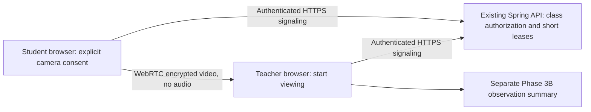

# Phase 3C — voluntary live video pilot

This phase adds **student-to-teacher live video**, alongside the independent Phase 3B observation panel. It is an adult-volunteer, local-network pilot: at most four sharing students per class and one teacher browser per student. It does not record video/audio, infer sleep/attention, verify facial identity, or change photo/manual attendance. A recipient could independently capture their screen; the application cannot prevent that.

## Architecture and limits

- Browser-native `RTCPeerConnection` uses send-only video at an ideal 640×360/15 fps. Teacher video tiles can be enlarged. Camera permission is requested only after explicit student consent and Start.
- The existing cookie login, CSRF protection, account-response checks and `StaffAccessService` protect signaling. Student eligibility, active enrollment and the class window (15 minutes before class until its end) are rechecked. Teachers/admins can only view authorized classes. Account labels identify senders, not verified people on camera.
- Short REST polls reuse existing infrastructure; no new server, model, package, database table or migration is required. Signaling, including SDP/network candidates, lives only in server memory and is never written to the database. Responses use `Cache-Control: no-store`; request bodies must not be logged by infrastructure.
- Student and viewer leases expire after 20 seconds. A five-second sweep removes expired signaling. Client watchdogs close media after a 15-second signaling gap when JavaScript can run. Stop/withdraw/panel close/page leave/log out releases local media. Server restart ends signaling; clients must explicitly restart. A browser completely suspended by its OS cannot execute cleanup until it resumes.
- Viewer release resets the SDP exchange. A second teacher window cannot take over an active viewer. A new viewing session uses a fresh viewer ID. SDP is bounded to 32 KB and audio/data-channel media sections are rejected. Capacity is four students per class, one stream per student, 100 total server streams.
- This is a **single-backend-instance pilot**. No external STUN/TURN server is contacted; connections are intended for localhost or compatible local networks. Browser/network policies may prevent even local connections. Direct peers can learn each other's network addresses; the student notice discloses this.
- For internet deployment, evaluate managed or self-hosted TURN with short-lived credentials and a relay-only option. For 20+ students, evaluate an SFU and subscription/quality controls, then measure bandwidth, latency, CPU and cost. Do not extrapolate two-browser tests into production capacity.

WebRTC references: [peer connections and TURN](https://webrtc.org/getting-started/peer-connections), [connection states](https://developer.mozilla.org/en-US/docs/Web/API/RTCPeerConnection/connectionState), [ICE gathering](https://developer.mozilla.org/en-US/docs/Web/API/RTCPeerConnection/iceGatheringState).

## Enable and test locally

1. Keep the existing database and start the usual local services. Set `LIVE_VIDEO_ENABLED=true` in the backend environment; the default is false. The local helper reads `data/local-dev/settings.json`. Restart the backend after changing it. No DB reset/migration is needed for 3C.
2. Use separate browser profiles/incognito contexts for student and teacher accounts; ordinary tabs share login cookies. Enroll an approved adult volunteer in a currently open class.
3. Student Overview → **Open live video sharing** → choose **Video class** → explicitly consent → **Start sharing live video** → allow camera access. The preview shows sharing status and the viewer's name when a teacher joins.
4. Teacher **Live monitoring** → select that class → **Start viewing live video**. Up to four sharing students appear. **Enlarge / Reduce** changes a tile's size. No video connection starts merely by opening the class page.
5. Student **Stop sharing live video**, uncheck consent, close the panel or leave the page: camera tracks stop and the teacher's tile disappears after the next refresh. Teacher **Stop viewing live video** closes receiving connections while students remain voluntarily available; starting viewing again negotiates fresh connections.
6. Disconnect signaling: the client closes media and requires explicit restart. Connection loss is not absence. The separate Phase 3B movement test has its own consent; 3C does not enable it automatically.
7. Repeat with two to four consenting adults and separate devices before deployment. Test mobile HTTPS/permissions, OS background suspension, network changes, class end, account/enrollment revocation, unauthorized access and competing teacher tabs.

## API contracts

All paths below start with `/api/live-video`. Mutations require CSRF; all endpoints require login.

| Method / path | Contract |
| --- | --- |
| GET `/students/{student}/sessions` | Student self only. `{enabled, noticeVersion, sessions:[{id,course,startTime,open}]}` |
| POST `/students/{student}/sessions/{session}/streams` | `{id, adultConfirmed:true, consent:true, noticeVersion}`; explicit new sharing run |
| POST `/students/{student}/streams/{stream}/pulse` | `{viewer: UUID|null, sdp: offer|null}`; renew student lease and receive viewer/answer |
| DELETE `/students/{student}/streams/{stream}` | Idempotent own-stream stop, including after pilot disablement |
| GET `/sessions/{session}/streams` | Authorized staff; `{enabled, streams}`; never returns SDP |
| POST `/sessions/{session}/streams/{stream}/viewer` | Authorized staff; `{viewer: UUID, sdp: answer|null}`; claim/renew one viewer and receive offer |
| DELETE `/sessions/{session}/streams/{stream}/viewer/{viewer}` | Release only caller's matching viewer; stale releases cannot remove a replacement |

Stream responses: `{id, studentId, name, viewer, viewerName, sdp}`. Signaling is bound to the session, student and teacher; UUID knowledge alone is not authorization. Expired or conflicting connections return 409, capacity 429, access failures 403, disabled mutations 503. No offline replay or background auto-reconnect is attempted.

## Implementation map and acceptance

Verified locally on 2026-10-26: 371 frontend tests and build passed; 11 live-video backend tests plus 21 observation/architecture regression tests passed. Real Chrome WebRTC sessions connected two temporary student accounts to one teacher using synthetic video sources. Decoded frames, outbound video bytes, no audio tracks, enlarge/reduce, teacher stop/rejoin, student consent withdrawal and signaling-failure cleanup passed. Desktop 1440×1000 and mobile-width 390×844 were checked without page errors or horizontal overflow. A viewer teardown/rejoin race discovered during browser QA was fixed by awaiting the previous viewer release. Temporary QA accounts and class were removed without creating attendance records. Real-device, separate-network, physical-camera and 20-user load tests remain outstanding.

- `backend/.../livevideo/LiveVideoService.java`: bounded in-memory signaling, consent, access and leases.
- `backend/.../livevideo/LiveVideoController.java`: authenticated, validated API contracts.
- `frontend/src/features/live-video`: student opt-in, teacher grid, peer lifecycle and API.
- Student desktop/mobile overview and teacher Live monitoring provide entry points. Phase 3B and photo attendance retain independent APIs and behavior.
- Backend tests cover authorization, CSRF, active enrollment, consent, class window/cancellation, owner/viewer isolation, stale offers, lease expiry, video-only limits and four-stream capacity.
- Frontend tests cover stop during a pending permission prompt, media/peer cleanup, network loss and scheduling gaps. Browser acceptance requires two simultaneous peers, decoded video frames, outbound video bytes, no audio tracks, enlarge/reduce, teacher stop/rejoin, student consent withdrawal and network-failure cleanup.
- Before 20-student rollout: define and measure a hardware/network budget, target connection success rate and p95 connection time, long-run stability and permission-revocation latency. Review institutional consent/access/retention requirements and TURN/SFU hosting before any operational deployment. This phase adds no automated emotion, fatigue or attention inference.
